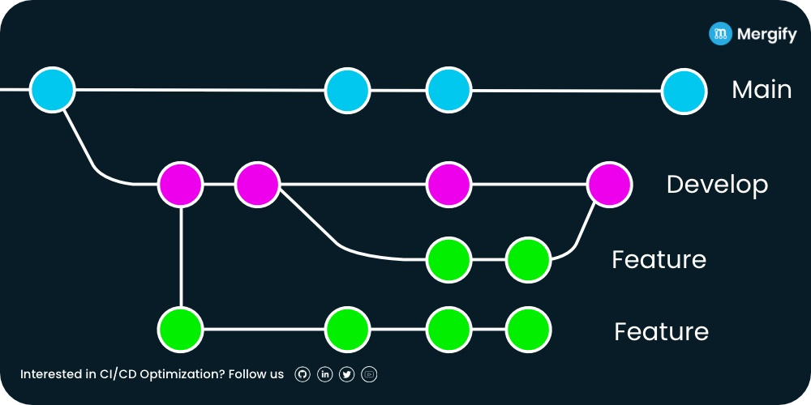

# Contributing & Collaboration Guide

This guide outlines general best practices and tips for collaborative work on programming-projects together - which also apply to the `oct_analysis` project.

From Git workflow basics to IDE tips.

---

## 1. Initial Setup

Refer to the provided **[Installation guide for developers](docs/INSTALL.md)**.


## 2. Git Workflow
### 2.1 Short Git Intro

- Git is a **version control system**. It tracks every change you make to the code, so you can go back in time, compare versions, and collaborate safely with others — without overwriting each other’s work.

  You work in your own isolated version ("branch"), and only **merge your work into the shared project when ready.**
- **What should be avoided?**
  Editing the wrong branch (`main` instead of `dev` or your `feature-branch`)

  Two people change the same file — Git will help you to decide which version to keep (merge conflict)
- **What you need to know:**
  Few commands will cover 90% of situations:
```bash
  git clone   # get the project
  git pull    # get the latest version from the online repository
  git checkout -b my-branch   # create new workspace (branch)
  git checkout branchname   # switch to other branch
  git add .   # include all changes to the next commit
  git commit -m "commit-message"  # save your changes locally with a descriptive message
  git push    # upload your commited changes
  git status  # get info about your current branch/changes/states
```
  You can checkout **[this video](https://www.youtube.com/watch?v=e9lnsKot_SQ)** for a visual guide.

  Last: **Pull Requests (PR)**. They are done on the github repository website:
  1. Go to `https://github.com/AndreasNetsch/oct_analysis`
  2. Switch to tab `Pull requests`
  3. Click green button `New pull request`
  4. Base = main/dev, compare = your-branch
  5. Create PR. You can then provide descriptions with your changes.
  6. Usually, someone else (if available) will review your changes and accept/decline the PR

### 2.2 How we use Git

We use a **main-dev** structure:



That means:

- **main branch**: Is stable. Only to be changed via merge from dev -> main
- **dev branch**: You can make minor changes on this branch. But try not to, and instead use feature branches.
- **feature branch**: Standard for changes, create your own feature branch (from dev)

### 2.3 Typical Workflow to Make Changes

0. Open console and navigate to `oct_analysis` folder
1. Start on dev: `git checkout dev`
2. Get latest changes: `git pull` (do this regularily)
3. Open/Switch to your feature-branch
4. Make changes, use `git commit -m "message"` to create version control points
5. Upload branch+changes to github: First `git pull`, then `git push`
6. Implement changes in dev: **Create Pull request** -> request will be reviewed (reach out to collaborators)

### 2.4 Advanced Options / Mistake Correction with Git

<!-- If the table shows a terrible format in your code editor, try allowing unlimited line lenght. In VSCode it works by hitting alt+z -->
| **Scenario** | **Solution** |
| ------------ | ------------ |
| You edited files while being on the wrong branch (e.g. main).<br>You haven't commited them yet. | 1. Use `git stash` to save changes in the "stash".<br>2. Create/switch to the correct branch.<br>3. Make sure it is up-to-date (`git pull`).<br>4. Apply your stashed changes with `git stash pop`. |
| You forgot to update (`git pull`) before upload (`git push`).<br> Git yells something about non-fast-forward. | 1. Use `git pull --rebase`.<br>2. Resolve any conflics (e.g. in VSCodes Merge Editor).<br>3. `git push` again. |
| Unknown scenarios.<br> You're stuck. | Describe the problem to AI/LLM.<br>Reach out to collaborators.<br> Solve it together if unsure. |

---

## 3. Working environment

We recommend using VSCode or Cursor as text editors to write Python code.

They both support AI writing assistance (like autocomplete on steroids).

In VScode for example you can add a lot of useful extensions:

 -> Python / Pylance / Github Copilot / indent-rainbow / PowerShell / Git Graph / ...

 -> it also makes using git much easier


## 4. Additional Useful Info

- While main and dev branches exists continuosly, a feature branch should exist as short as possible. Few days are okay, few weeks not so good.
- Use descriptive messages for your commits: "added function to cut rhomboid", "fixed bug in function_xy that caused xyz"
- Ask for help when needed — Git keeps everything (you committed/pushed), and you can always undo mistakes (you committed/pushed).
- Instead of the console, you can use GUI programs to work with Git - same principles apply
 -> GitHub Desktop / Git Extensions / VSCode Extensions
- **Best practices in a nutshell:**
 Don’t work directly on main.

 Don’t keep feature branches alive for weeks.

 Pull often. Commit often. Push when stable.

 Ask if unsure.
